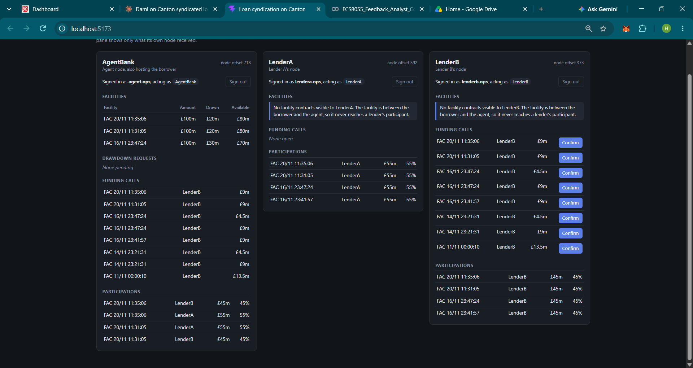

# canton-loan-syndication

A syndicated loan workflow on Canton. An agent bank, a borrower and two lenders share one workflow, but each participant node only receives the parts its parties are stakeholders in.

Work in progress. The privacy design is in [docs/design/stakeholder-matrix.md](docs/design/stakeholder-matrix.md).

## What it looks like

Three organisations, each with its own participant node and its own backend. Signed in on the agent's node as the agent's operations team, you see every participation and funding call the agent is party to:

The same node, signed in as the borrower's treasury. The node stores both lenders' participations and funding calls, but the borrower is not a stakeholder in any of them, so the borrower's user sees none ([ADR 0005](docs/adr/0005-people-parties-and-visibility.md)). Each lender only ever sees its own share:

Stack: Daml SDK 3.6.3 (LF 2.3), Canton, Java, React, Postgres, Docker Compose.

Licence: Apache-2.0
