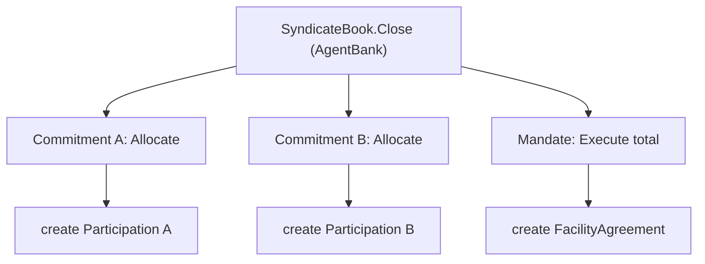

# Stakeholder matrix

Status: accepted, 2026-10-26

Every template in `daml/loan-model` follows this design. In Daml the stakeholders of a contract decide which participant nodes ever receive it, so this is the privacy design as much as the access control design.

## Parties

| Party | Role | Hosted on |
|---|---|---|
| Borrower | company raising the facility | participant-agent |
| AgentBank | arranger and facility agent, runs the book | participant-agent |
| LenderA | syndicate member | participant-lenderA |
| LenderB | syndicate member | participant-lenderB |

## Rules the design relies on

1. Signatories and observers of a contract see it created and archived. Every signatory must authorise the create.
2. An informee of an exercise sees the whole subtree of that exercise, including the choice arguments and every contract created inside it.
3. A choice body runs with the authority of the contract's signatories plus the controller. There is no caller chain like `msg.sender`.

So anything that must stay private from a party hangs off a contract that party is not a stakeholder of.

## Contracts

| Contract | Signatories | Observers | Choices (controller) |
|---|---|---|---|
| MandateRequest | Borrower | AgentBank | Accept (AgentBank) creates Mandate |
| Mandate | Borrower, AgentBank | | Execute total (AgentBank) creates FacilityAgreement |
| SyndicateBook | AgentBank | | Invite (AgentBank), Close (AgentBank) |
| LenderInvitation | AgentBank | Lender | Commit amount, Decline (Lender) |
| Commitment | AgentBank, Lender | | Allocate amount (AgentBank) creates Participation |
| Participation | AgentBank, Lender | | CallFunds, Distribute (AgentBank) |
| FacilityAgreement | Borrower, AgentBank | | RequestDrawdown (Borrower) |
| DrawdownRequest | Borrower | AgentBank | Approve (AgentBank) creates Drawdown |
| Drawdown | Borrower, AgentBank | | |
| FundingCall | AgentBank | Lender | ConfirmFunded (Lender) |
| RepaymentNotice | Borrower | AgentBank | Acknowledge (AgentBank) |
| Distribution | AgentBank | Lender | ConfirmReceipt (Lender) |

## Who sees what

"own" means the lender sees its own instance and never the other lender's.

| Contract | Borrower | AgentBank | LenderA | LenderB |
|---|---|---|---|---|
| MandateRequest, Mandate | yes | yes | no | no |
| SyndicateBook | no | yes | no | no |
| LenderInvitation, Commitment, Participation | no | yes | own | own |
| FacilityAgreement, DrawdownRequest, Drawdown | yes | yes | no | no |
| FundingCall, Distribution | no | yes | own | own |
| RepaymentNotice | yes | yes | no | no |

The privacy test script in `daml/loan-tests` asserts this table row by row.

## Key transactions

### Opening the mandate

AgentBank submits two commands in one transaction: `MandateRequest.Accept` and a create of `SyndicateBook`. They are separate roots, so the borrower is an informee of the first and not the second. If the book were created inside `Accept`, rule 2 would show it to the borrower.

### Closing the book

AgentBank exercises `SyndicateBook.Close`. One atomic transaction, three different projections.

AgentBank sees the whole tree. LenderA sees only the Allocate A subtree and LenderB only Allocate B. The borrower sees only Execute and the facility it creates, which carries the total but not the split.

The lender's signature on Participation comes from the Commitment it already signed (rule 3), not from the lender taking part in the close.

### Drawdown and repayment

AgentBank submits `DrawdownRequest.Approve` together with one `Participation.CallFunds` per lender as separate roots in one submission. It is atomic, and the borrower never sees the pro rata split. Repayment distribution works the same way with `Distribute`.

## Decisions

- Lender identities are hidden from each other. The alternative was a SyndicateRoster contract listing names to all lenders, which is closer to market practice. Rejected for v1 because it weakens the privacy demo, and it can be added later without touching existing templates.
- The cash leg stays off ledger. Contracts record instructions and confirmations. An on-ledger cash leg using the Canton token standard is a possible extension.
- The borrower is co-hosted with the agent, so the borrower is restricted at party level, not node level. The physical privacy proof uses LenderA against LenderB. A fourth participant for the borrower is a stretch goal.
- No contract keys. Contract ids are passed explicitly. Keys in Daml 3.5 and later are non-unique, and nothing here needs a lookup by business id.
